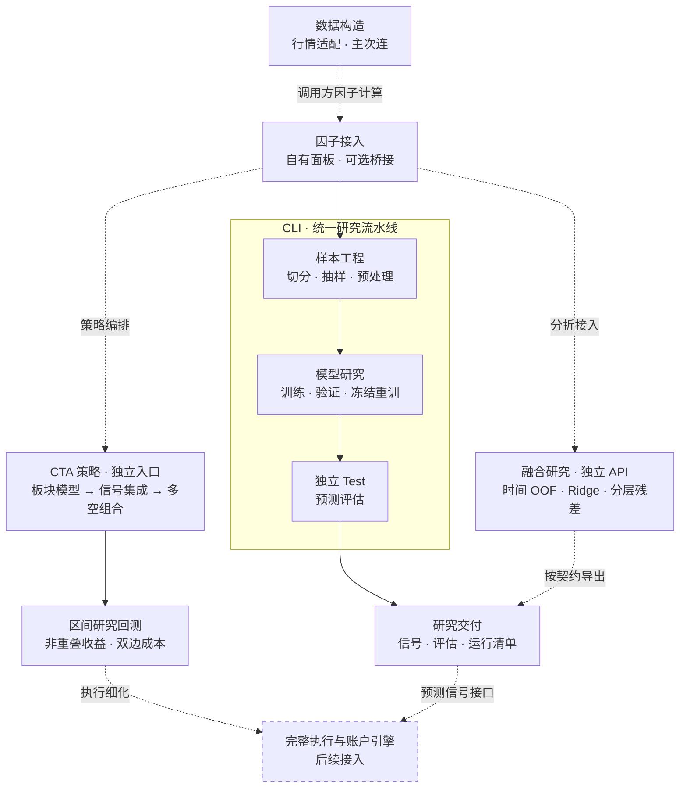

# Quant-Display

**量化研究全流程架构与工程实现**

[](https://github.com/meijiahao003-prog/Quant-Display/actions/workflows/research-tests.yml)

以统一数据契约连接行情与合约构造、因子接入、样本工程、机器学习实验和预测交付，支持商品期货研究，并提供股票因子面板的可选接入方式。

**当前范围：数据与模型研究、商品期货截面多空 CTA 策略及区间研究回测。** 完整交易执行与账户引擎保留后续接入契约；部分因子库与 CTA 策略分别作为独立成果展示。公开内容包括工程代码、研究文档与合成示例。

[全流程架构](#全流程架构) · [模块与入口](#模块与入口) · [研究工程约束](#研究工程约束) · [因子成果展示](#已实现的部分因子库展示) · [CTA 策略展示](#商品期货截面多空-cta-策略展示) · [快速开始](#快速开始) · [回测接入](#回测后续接入)

## 全流程架构



**CLI 从已计算的因子面板开始。** 行情构造、快照桥接和融合研究提供独立 API；虚线表示需要调用方显式衔接的计算或后续模块。已有因子面板可直接进入研究流水线，各资产保留独立的身份、日历和数据时点规则。

## 模块与入口

| 模块 | 核心能力与产物 | 使用方式 |
| --- | --- | --- |
| 数据构造 | 合约身份与日历校验、主次连映射、T+1 生效、原价与换月审计 | [独立 API：连续合约与适配器](docs/futures/continuous.md) |
| 因子接入 | 自有因子矩阵及时间元数据；可选地将单时点输出桥接为面板 | [数据契约](docs/futures/reproducibility.md) / [快照桥接 API](docs/system/factor_bridge.md) |
| 样本工程 | 精确时刻抽样、跨边界标签清理、Fit 标准化、分组与 PCA、质量检查 | [CLI 编排与处理模块](docs/futures/factors.md) |
| 模型训练与测试 | 验证期选择轮数、冻结后重训、独立 Test、按时间与资产分析预测 | [CLI 与训练 API](docs/futures/training.md) |
| 融合研究 | 时间顺序 OOF、Ridge stacking、分层核心与残差模型 | [独立研究 API](docs/futures/training.md) |
| 研究交付 | 预测信号、模型比较、冻结状态、输入指纹与产物哈希 | [运行产物与复现](docs/futures/reproducibility.md) |
| CTA 策略 | 板块独立训练、固定权重排名融合、主次力多空组合、区间研究回测 | [独立策略入口](docs/strategies/sector_cta.md) |

已完成合成流程验证的模型包括 **XGBoost、LightGBM、Transformer、iTransformer**。Transformer 使用时间 token，iTransformer 使用因子 token；具体输入与训练协议见[模型文档](docs/futures/training.md)。

## 研究工程约束

研究流程以可用时间和冻结状态为边界，保留每一步的数据与配置来源。

| 约束 | 实现与核验方式 |
| --- | --- |
| 信息时点 | 样本携带 `feature_available_at` 与 `label_end`；连续合约在 T 收盘决策、下一交易日生效，保留原始价格与换约记录 |
| 样本隔离 | 按时间切分；训练/选参标签执行 purge / embargo，Test 未知标签只影响评分，不影响信号成员 |
| 处理器冻结 | 时间序列标准化与 PCA 在 Fit 上拟合；CTA 截面标准化只使用同刻板块信息；OOF 各折遵守训练边界 |
| 训练与评估 | Fit 训练、Valid 选择轮数，随后以固定轮数在 Fit+Valid 重训；全部模型冻结后再由流水线加载 Test |
| 可追溯与复现 | 保存随机种子、配置、数据指纹、处理器状态、源码及产物 SHA-256，并记录依赖环境 |

时间声明需要上游数据证据支撑；供应商修订、历史资产池和财报披露时间仍需单独核验。查看 Test 后继续选模型或修改规则，需要新的未查看区间。合成测试验证软件行为，不能替代真实市场有效性或交易可实现性验证。

## 已实现的部分因子库展示

**独立成果展示：以下九个股票因子是已完成因子库的部分公开示例。** 它们不限定系统的因子数量、输入范围或处理流程。每个示例保留代码、定义、研究假设及历史诊断资料。

| 研究方向 | 展示示例 | 实现 |
| --- | --- | --- |
| 市场微观结构 | F01 隔夜尾盘资金冲击 · F02 开收盘成交量集中度 · F03 散户资金同步 · F04 机构尾盘加速 · F05 VWAP 与资金流背离 | [源码](src/ashare_factor_lab/factors/microstructure) |
| 风险 | F06 混合周期特质偏度 | [源码](src/ashare_factor_lab/factors/risk) |
| 交易活跃度 | F07 成交额稳定性 · F08 换手率稳定性 | [源码](src/ashare_factor_lab/factors/trading_activity) |
| 基本面 | F09 综合质量 | [源码](src/ashare_factor_lab/factors/fundamental) |

[展示说明](docs/ashare_factor_research.md) · [因子卡片与检验思路](docs/factor_cards.md) · [历史研究结果](results/README.md) · [全样本汇总](results/summary.csv) · [年度汇总](results/annual_metrics.csv)

历史结果作为研究档案保留，本次系统整理未重新运行其底层真实数据，也未重新确认收益有效性。

## 商品期货截面多空 CTA 策略展示

**按商品板块独立建模，预测未来 30 分钟相对板块收益，并由集成信号构建主力、次主力合约的多空组合。** 这是独立策略成果，贯通数据契约、训练、预测、组合和研究回测。

| 环节 | 策略实现 |
| --- | --- |
| 板块建模 | 黑色、金属、能源化工、农产品分别训练；分组为研究配置 |
| 预测目标 | 未来 30 分钟原始收益 − 同时点所属板块收益中位数 |
| 模型与融合 | XGBoost、LightGBM、Transformer、iTransformer；板块内预测排名后以冻结权重融合 |
| 组合构建 | 显式区分主力 / 次主力；板块内多空配权、固定板块资金比例 |
| 研究评估 | 非重叠区间收益、双边交易成本、净值与回撤；保留独立执行引擎接入口 |

以最新分板块 Notebook 为主要研究依据：原件实际默认训练 **LightGBM**、标签采用板块内 z-score；公开版以 **减板块中位数**为默认标签，保留 z-score 可选模式，并新增四模型排名集成。这些差异及来源位置均可追溯，未公开原始数据或历史私人业绩。

[策略说明与来源证据](docs/strategies/sector_cta.md) · [合成演示](examples/run_sector_cta_demo.py) · [配置示例](configs/sector_cta.example.json) · [策略编排](src/futures_research/cta_strategy.py)

## 快速开始

推荐 Python 3.11 / 3.12。在仓库根目录创建环境并运行合成演示：

```bash
python -m venv .venv
source .venv/bin/activate
python -m pip install -e '.[futures,futures-models,dev]'
quant-research demo --output runs/demo
```

默认演示使用 XGBoost。四模型比较与真实数据运行分别使用：

```bash
quant-research demo \
  --models xgboost,lightgbm,transformer,itransformer \
  --output runs/comparison

quant-research run --config configs/research.example.json --output runs/real
```

真实数据运行前须填写[示例配置](configs/research.example.json)，提供相互独立的 Train/Valid 与 Test 文件；路径相对配置文件解析。输出目录必须为新目录。`futures-research` 是兼容入口，macOS 的 OpenMP 依赖及完整环境说明见[接入与复现指南](docs/futures/reproducibility.md)。

一次成功运行会生成：

| 产物 | 内容 |
| --- | --- |
| `signals.csv` | 不含未来标签的模型预测，供后续回测按契约读取 |
| `evaluation/`、`model_comparison.csv` | 预测指标与模型描述性比较 |
| `models/`、`pca_states/` | 本地模型及处理器状态，按实际配置生成 |
| `config.json`、`selection.json`、`manifest.json` | 配置、模型选择记录、数据与产物指纹、运行状态 |

<details>
<summary>可选示例与软件检查</summary>

```bash
# 独立运行部分因子库的合成展示
python examples/run_synthetic_demo.py

# 用示例因子演示可选快照桥接和模型训练
python examples/run_factor_bridge_demo.py --output runs/equity-bridge

# 商品期货 CTA：默认 LightGBM；可用 --models 指定四模型
python examples/run_sector_cta_demo.py --output runs/sector-cta

# 软件回归与公开发布检查
python -m pytest -q
python tools/check_public_release.py
```

示例使用合成数据；预测指标不代表真实市场收益。已运行的检查与未覆盖范围见[验证记录](docs/futures/verification.md)。

</details>

## 回测后续接入

已定义[研究预测到交易回测的接入契约](docs/system/backtest_contract.md)。后续模块将以预测信号或策略目标仓位、真实合约映射和运行清单为输入，补充成交模拟、持续持仓与资金账本、保证金、移仓及风险约束。

**CTA 策略已包含受限的区间研究回测；完整交易执行引擎仍待接入。** 研究回测每区间独立开平，不能替代真实期货持仓、保证金及结算账本。通用 CLI 的 `signals.csv` 仍是预测输出；CTA 独立入口另行输出 `target_weights.csv` 和研究曲线。两者都采用零推理/传输延迟的研究假设，实际交易须核验信号可得时间、成交价格、换约和成本。

## 文档与研究资料

| 主题 | 入口 |
| --- | --- |
| 使用与模块说明 | [研究系统指南](docs/futures/README.md) · [数据与复现](docs/futures/reproducibility.md) · [训练与融合](docs/futures/training.md) |
| 工程边界 | [连续合约](docs/futures/continuous.md) · [因子处理与 QC](docs/futures/factors.md) · [回测契约](docs/system/backtest_contract.md) |
| 研究来源 | [阶段工作总结](docs/futures/research_summary.md) · [18 份材料的来源哈希](docs/futures/source_manifest.json) |
| 公开验证 | [脱敏说明](docs/futures/sanitization.md) · [软件验证记录](docs/futures/verification.md) · [泄漏与逻辑复核](docs/system/leakage_audit.md) · [GitHub Actions](https://github.com/meijiahao003-prog/Quant-Display/actions) |

<details>
<summary>仓库目录</summary>

```text
src/futures_research/   数据构造、因子处理、模型、融合与 CLI
src/quant_research/     可选的因子快照桥接
src/ashare_factor_lab/  部分因子库展示及配套研究工具
configs/               公开配置示例
docs/system/           跨模块数据契约与回测接入约定
docs/futures/           研究模块说明、来源及验证
docs/strategies/        独立策略展示、来源差异及实现边界
results/               已归档的股票因子研究结果
examples/              合成演示与可选接入示例
tests/                 合成数据与时间边界回归测试
tools/                 结果生成与公开发布检查
```

保留原有包名及入口以兼容既有研究代码，资产类别以数据契约声明为准。

</details>

公开仓库不包含私人行情、账号凭据、训练权重或原始 Notebook 输出。真实数据与运行产物默认保存在本地忽略目录；当前未附加开源许可证，代码、数据和第三方材料的再使用需遵守相应权利边界。


## 识盘 · 市场监控与投资研究平台

[进入识盘子项目](projects/shipan/README.md)：由观市平台移植，提供指数与 ETF 看盘、资金分时、宏观先导及本地三专家投资 Agent。包含独立启动入口、数据接口和测试；每日宏观自动化需单独配置。

