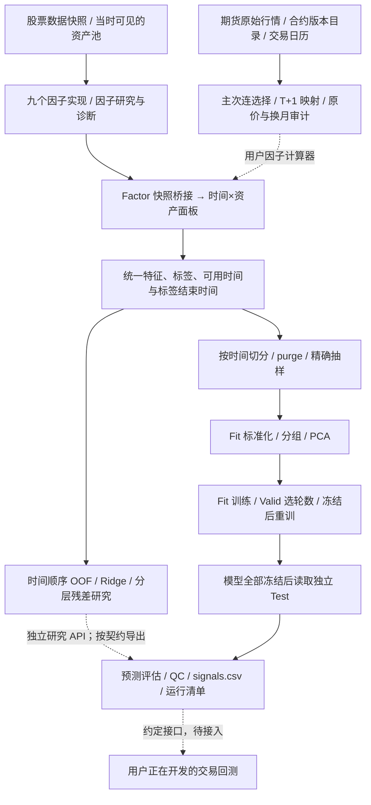

# Quant Factor Display · 量化研究系统

这个仓库整理一条持续演进的量化研究链路：**因子挖掘与研究 → 行情构造与因子引用 → 数据处理与抽样 → 模型训练与融合 → 预测评估 → 回测接入**。

原有九个股票因子及研究成果保留为上游研究层；本次加入的期货主次连、因子工程、模型比较与融合模块接在统一数据契约之下。股票和期货共享处理与训练协议，同时保留各自的资产身份、交易日历、数据可用时间及计算规则。

**目前已实现研究与预测链路；交易回测正在另行开发，后续按接口接入。** 仓库不把模型 IC、预测误差或连续价格涨跌称为可实现策略收益。这里公开源码、文档和合成测试，不发布私人行情、账号凭据、训练权重或原 Notebook 输出。

## 全流程结构



虚线表示需要显式接入的环节。基础 CLI 编排标准化、分组/PCA、单模型及多模型比较；OOF、Ridge 和分层残差提供独立研究 API。它不会自动将每个股票因子公式移植到期货，也不会生成未提供的专有因子。

| 层 | 代码与文档 | 状态 |
| --- | --- | --- |
| 因子挖掘与研究 | [原股票因子库与历史成果](docs/ashare_factor_research.md)、[因子卡片](docs/factor_cards.md) | 保留九个因子及历史研究档案 |
| 上游因子引用 | [快照桥接](docs/system/factor_bridge.md)、`quant_research.factor_bridge` | 将单时点 `(1, n_assets)` 因子输出转为统一面板 |
| 期货数据构造 | [连续合约](docs/futures/continuous.md)、`continuous.py`、`adapters.py` | 完整身份、版本目录、日历、主次连与缺口审计 |
| 数据与样本工程 | [处理、分组、采样与 QC](docs/futures/factors.md) | Fit 标准化、PCA、时点验证与标签 purge |
| 模型训练与融合 | [训练与融合](docs/futures/training.md) | 树模型、Transformer/iTransformer、OOF、Ridge 与分层残差 |
| 编排与复现 | [接入与复现](docs/futures/reproducibility.md)、[示例配置](configs/research.example.json) | 配置驱动运行、独立 Test、预测和来源清单 |
| 交易回测 | [后续接入契约](docs/system/backtest_contract.md) | 接口已约定，执行、持仓及损益引擎待接入 |

## 快速运行

建议 Python 3.11 或 3.12，在仓库根目录运行：

```bash
python -m venv .venv
source .venv/bin/activate
python -m pip install -e '.[futures,futures-models,dev]'
python -m pytest -q
quant-research demo --output runs/demo
```

`quant-research` 与兼容入口 `futures-research` 调用同一条研究流水线。合成演示默认使用 XGBoost；比较四种模型时使用新的输出目录：

```bash
quant-research demo \
  --models xgboost,lightgbm,transformer,itransformer \
  --output runs/comparison
```

每个模型先在 Fit/Valid 阶段选择轮数，再从新模型开始训练固定轮数；所有模型冻结后才调用独立 Test loader。合成数据用于流程验证，指标没有市场或投资含义。macOS 树模型还需可加载的 OpenMP 运行库，详见[环境说明](docs/futures/reproducibility.md)。

真实数据需要相互独立的 Train/Valid 与 Test 文件，并修改示例配置：

```bash
quant-research run --config configs/research.example.json --output runs/real
```

`dataset` 路径相对配置文件解析；示例不包含真实数据。已有输出目录会被拒绝覆盖，失败重试也使用新目录。原股票因子的轻量演示仍可运行：

```bash
python examples/run_synthetic_demo.py
```

## 数据与防泄漏约束

统一面板以 `Date, Contract, Datetime` 为样本键。`Contract` 是兼容的资产 ID 字段，股票也可使用，不意味着股票变成期货合约。每行必须附带 `feature_available_at` 与 `label_end`，说明特征及标签最晚可用时点。夜盘交易日由数据层提供，不能从自然日期猜测。

- 先按时间划分并清除跨边界标签，再拟合处理器和模型；每个 OOF 窗口的转换也必须遵守其训练边界。
- 因子桥接读取当时可见的快照。合法时间声明不代替供应商修订历史、财报披露时间与历史资产池证据。
- 连续合约的“30 天”是最后交易日前的自然日禁入窗口。T 收盘选约下一交易日生效；原价缺失不造平，因果比例调整不使用未来换约回改历史。
- Test 是冻结后的评估集。根据 Test 排名继续选特征、改参数或筛策略后，必须另留未查看的最终确认区间。
- 预测评估与交易回测分别记录。换约跳变、复权涨跌和模型相关系数都不能替代真实合约持仓、成本与成交约束。

## 原股票成果与本次整理记录

- [原股票因子项目说明](docs/ashare_factor_research.md)
- [历史结果目录](results/README.md)、[全样本汇总](results/summary.csv)、[年度汇总](results/annual_metrics.csv)
- [工作总结及 17 份材料对应关系](docs/futures/research_summary.md)
- [来源哈希清单](docs/futures/source_manifest.json)
- [脱敏与发布检查](docs/futures/sanitization.md)
- [本次软件验证记录](docs/futures/verification.md)

原股票结果是已归档的研究材料，本次接入没有重新运行其底层真实数据，也没有重新确认收益有效性。软件验证、合成演示和历史实证档案分开标记。

## 仓库布局

```text
src/ashare_factor_lab/   原股票因子、数据接口、算子与研究诊断
src/quant_research/      跨层因子快照桥接
src/futures_research/    连续合约、公共数据处理、模型、融合与 CLI
configs/                可公开的研究配置示例
docs/system/            跨层数据契约与后续回测接口
docs/futures/           本次研究模块说明、来源及验证
results/                保留的股票历史研究档案
tests/                  合成数据与边界回归测试
tools/                  原结果生成工具及公开发布检查
```

保留已有包名和入口以兼容研究代码，不按目录名称推断资产类别。真实数据与运行产物写入本地忽略目录；发布前运行 `python tools/check_public_release.py` 并人工审阅变更。当前没有新增开源许可证，后续分发需尊重代码、数据及第三方材料的权利边界。
