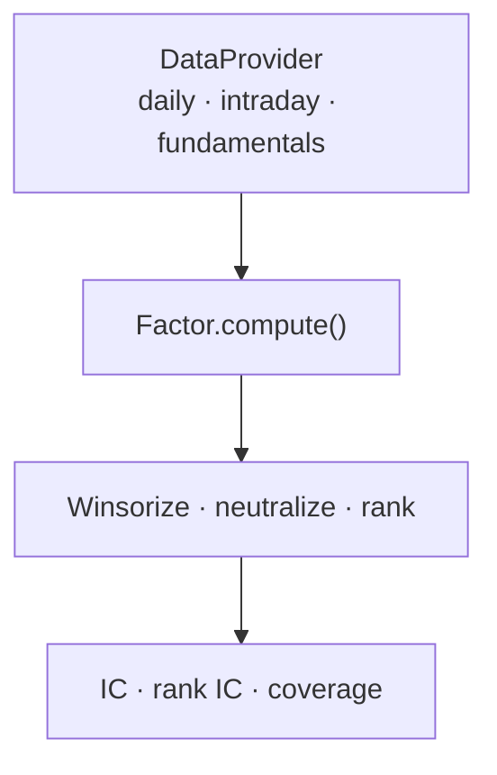

# Quant Factor Display

A compact, research-oriented toolkit for prototyping cross-sectional equity factors on
Chinese A-share data. The project separates data access, signal construction, cross-sectional
post-processing, and evaluation so that the same research logic can be tested with different
data vendors.

The repository contains **nine independently implemented factors** covering market
microstructure, trading activity, risk, and fundamental quality.

> This is a sanitized portfolio project. It contains no proprietary datasets, internal research
> infrastructure, credentials, production paths, or employer-owned source code. The included
> synthetic data is designed only to test software behavior and does not demonstrate investment
> performance.

## Factor catalogue

| Theme | Factor | Core intuition | Horizon |
|---|---|---|---:|
| Microstructure | Overnight Tail-Flow Shock | Large overnight residual shocks combined with abnormal closing-hour order-flow imbalance may revert | 5 days |
| Microstructure | Open/Close Volume Concentration | Persistent concentration of trading at the open and close captures crowded attention and liquidity demand | 20 days |
| Microstructure | Retail Flow Synchronization | Retail flow that closely follows lagged returns may indicate extrapolative trading and subsequent reversal | 20 days |
| Microstructure | Institutional Tail Acceleration | Combines persistent institutional net flow with the change from morning to closing-session pressure | 20 days |
| Microstructure | VWAP–Flow Divergence | Disagreement between early-session VWAP behavior and directional order flow may reveal price-pressure divergence | 20 days |
| Risk | Mixed-Horizon Idiosyncratic Skewness | Penalizes lottery-like residual return distributions using an FP-inspired mixed-horizon beta estimate | 21/252/750 days |
| Trading activity | Dollar-Volume Stability | Lower variation in traded value represents a more stable liquidity regime | 126 days |
| Trading activity | Turnover Stability | Measures turnover stability and partially removes overlapping dollar-volume variation | 75 days |
| Fundamentals | Composite Quality | Combines profitability, growth, earnings quality, operating efficiency, and balance-sheet safety | Quarterly |

## Design



All factor implementations accept a `DataProvider` rather than importing a vendor-specific
SDK. This keeps the research layer testable and makes timing conventions explicit.

## Quick start

```bash
python -m venv .venv
source .venv/bin/activate
pip install -e ".[dev]"
python -m unittest discover -s tests
python examples/run_synthetic_demo.py
```

Example:

```python
from ashare_factor_lab.data import SyntheticDataProvider
from ashare_factor_lab.factors import DollarVolumeStability

data = SyntheticDataProvider(seed=7, n_assets=300)
signal = DollarVolumeStability().compute(data)
```

Every factor returns a `1 × n_assets` NumPy array. Inputs use only information available at
the formation date. Portfolio formation, execution assumptions, fees, and market-impact
modeling intentionally remain outside the signal layer.

## Evaluation principles

The evaluation utilities support Pearson IC, rank IC, IC information ratio, sign consistency,
and cross-sectional coverage. A serious empirical study should additionally report:

- year-by-year and market-regime stability;
- 1-day and multi-day signal decay;
- turnover and transaction-cost sensitivity;
- industry and size exposure before and after neutralization;
- correlation with an existing factor library;
- point-in-time universe membership and disclosure-date alignment for fundamentals.

Synthetic demo outputs must not be interpreted as backtest results.

## Research lineage

The factor set includes adaptations inspired by the global characteristic literature and mixed-
horizon beta estimation. Relevant primary references include:

- Frazzini, A. and Pedersen, L. H. (2014),
  [“Betting Against Beta”](https://doi.org/10.1016/j.jfineco.2013.10.005),
  *Journal of Financial Economics* 111(1), 1–25.
- Jensen, T. I., Kelly, B. T., and Pedersen, L. H. (2023),
  [“Is There a Replication Crisis in Finance?”](https://doi.org/10.1111/jofi.13249),
  *The Journal of Finance* 78(5), 2465–2518.
- Boyer, B., Mitton, T., and Vorkink, K. (2010),
  [“Expected Idiosyncratic Skewness”](https://doi.org/10.1093/rfs/hhp041),
  *The Review of Financial Studies* 23(1), 169–202.

The microstructure combinations are research hypotheses rather than replications of the cited
papers. See [`docs/factor_cards.md`](docs/factor_cards.md) for definitions and implementation
notes.

## Reproducibility and disclosure

- No raw market or fundamental data is distributed.
- Field names are generic and must be mapped by the user's own data adapter.
- The fundamental factor requires point-in-time, announcement-date-aligned statements.
- The project makes no claim that historical relationships will persist or survive trading costs.
- This repository is for research and educational use, not investment advice.

No open-source license has been attached yet. Add a license only after confirming ownership and
the intended reuse terms for the public repository.
