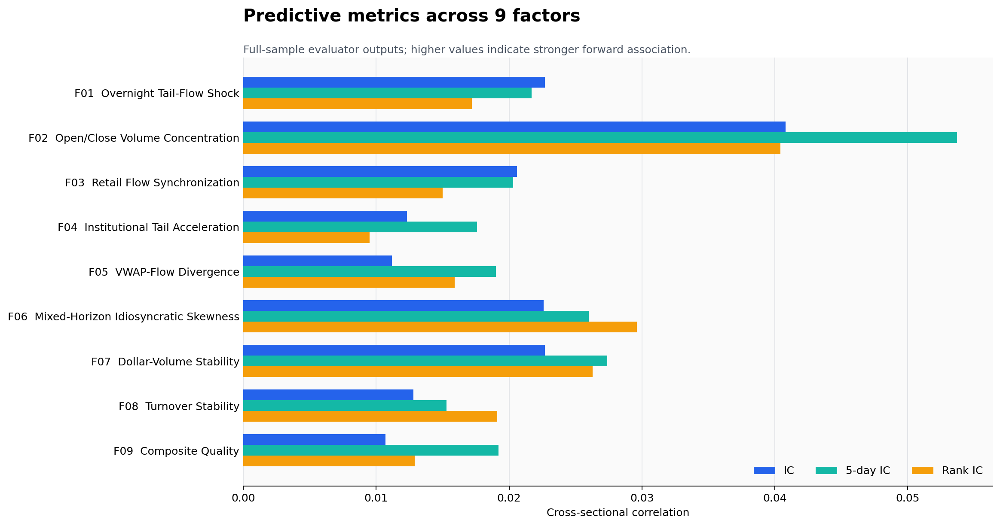
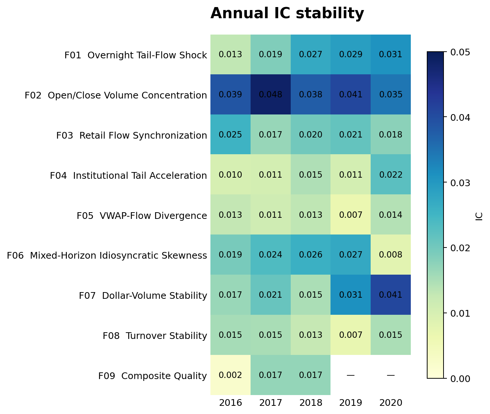
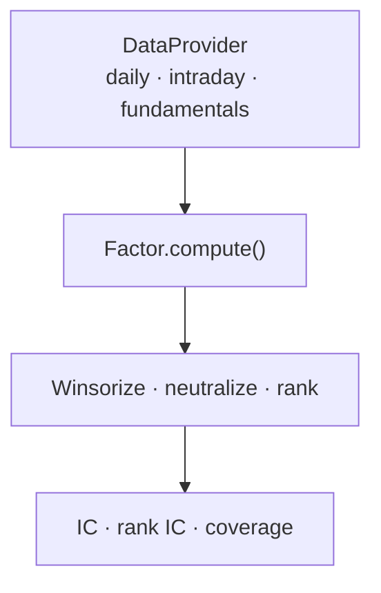

# Quant Factor Display

A compact, research-oriented toolkit for prototyping and documenting cross-sectional equity
factors on Chinese A-share data. The project separates data access, signal construction,
cross-sectional post-processing, and evaluation so that the same research logic can be tested
with different data vendors.

The repository contains **nine independently implemented factors** plus sanitized historical
evaluation summaries covering market microstructure, trading activity, risk, and fundamental
quality.

> This is a sanitized portfolio project. It contains no proprietary datasets, internal research
> infrastructure, credentials, production paths, or employer-owned source code. Synthetic data
> is used for reproducible software tests; the separately labelled empirical section reports
> archived research diagnostics without distributing the underlying market data.

## Factor catalogue

| ID | Theme | Factor | Core intuition | Horizon |
|---|---|---|---|---:|
| F01 | Microstructure | [Overnight Tail-Flow Shock](../src/ashare_factor_lab/factors/microstructure/overnight_tail_flow.py) | Overnight residual shocks combined with abnormal closing-hour order-flow imbalance may revert | 5 days |
| F02 | Microstructure | [Open/Close Volume Concentration](../src/ashare_factor_lab/factors/microstructure/volume_concentration.py) | Persistent session-boundary activity captures crowded attention and liquidity demand | 20 days |
| F03 | Microstructure | [Retail Flow Synchronization](../src/ashare_factor_lab/factors/microstructure/retail_flow_sync.py) | Retail-proxy flow that follows lagged returns may indicate extrapolative trading | 20 days |
| F04 | Microstructure | [Institutional Tail Acceleration](../src/ashare_factor_lab/factors/microstructure/institutional_tail_acceleration.py) | Persistent large-trade flow is combined with closing-session acceleration | 20 days |
| F05 | Microstructure | [VWAP–Flow Divergence](../src/ashare_factor_lab/factors/microstructure/vwap_flow_divergence.py) | Early-session price formation is compared with directional order flow | 20 days |
| F06 | Risk | [Mixed-Horizon Idiosyncratic Skewness](../src/ashare_factor_lab/factors/risk/fp_idiosyncratic_skew.py) | Lottery-like residual return distributions are penalized using a mixed-horizon beta | 21/252/750 days |
| F07 | Trading activity | [Dollar-Volume Stability](../src/ashare_factor_lab/factors/trading_activity/dollar_volume_stability.py) | Lower variation in traded value represents a more stable liquidity regime | 126 days |
| F08 | Trading activity | [Turnover Stability](../src/ashare_factor_lab/factors/trading_activity/turnover_stability.py) | Turnover stability is separated from overlapping dollar-volume variation | 75 days |
| F09 | Fundamental | [Composite Quality](../src/ashare_factor_lab/factors/fundamental/composite_quality.py) | Profitability, growth, earnings quality, efficiency, and balance-sheet safety are combined | Quarterly |

Detailed definitions, sign conventions, and falsification tests are in
[`docs/factor_cards.md`](factor_cards.md).

## Empirical snapshot

The public result catalogue contains the supplied historical evaluator outputs, normalized into
machine-readable full-sample and annual tables. Seven of nine factors passed the configured
research gate; F03 and F09 are deliberately retained as diagnostic cases instead of being hidden.
F02 has the strongest full-sample IC and 5-day IC, while F06 has the highest rank ICIR.

[Open the complete result catalogue →](../results/README.md)





These are research diagnostics, not live returns. The public summaries do not include raw
parquet data, transaction costs, capacity estimates, or a claim of future persistence.

## Design



All factor implementations accept a `DataProvider` rather than importing a vendor-specific
SDK. This keeps the research layer testable and makes timing conventions explicit.

## Quick start

```bash
python -m venv .venv

# macOS / Linux
source .venv/bin/activate

# Windows PowerShell
# .venv\Scripts\Activate.ps1

pip install -e ".[dev]"
python -m unittest discover -s tests
python examples/run_synthetic_demo.py
```

Example:

```python
from ashare_factor_lab.data import SyntheticDataProvider
from ashare_factor_lab.factors import DollarVolumeStability

data = SyntheticDataProvider(seed=7, n_assets=300)
signal = DollarVolumeStability().compute(data)
```

Every factor returns a `1 × n_assets` NumPy array. Inputs use only information available at
the formation date. Portfolio formation, execution assumptions, fees, and market-impact
modeling intentionally remain outside the signal layer.

## Evaluation principles

The evaluation utilities support Pearson IC, rank IC, IC information ratio, sign consistency,
and cross-sectional coverage. A serious empirical study should additionally report:

- year-by-year and market-regime stability;
- 1-day and multi-day signal decay;
- turnover and transaction-cost sensitivity;
- industry and size exposure before and after neutralization;
- correlation with an existing factor library;
- point-in-time universe membership and disclosure-date alignment for fundamentals.

Synthetic demo outputs must not be interpreted as backtest results.

## Repository layout

```text
src/ashare_factor_lab/factors/
├── microstructure/       # F01–F05
├── risk/                 # F06
├── trading_activity/     # F07–F08
└── fundamental/          # F09
results/
├── summary.csv           # normalized full-sample metrics
├── annual_metrics.csv    # year-level stability metrics
├── factor_reports/       # one evidence card per factor
├── figures/              # regenerated comparison charts
└── full_reports/         # archived evaluator panels
```

To regenerate the public result pages and charts:

```bash
pip install -e ".[reports]"
python tools/generate_result_assets.py
```

The category registry is exposed as `FACTOR_GROUPS`. See
[`docs/adding_factors.md`](adding_factors.md) for the checklist used to add a factor without
breaking numbering, documentation, or result coverage.

## Research lineage

The factor set includes adaptations inspired by the global characteristic literature and mixed-
horizon beta estimation. Relevant primary references include:

- Frazzini, A. and Pedersen, L. H. (2014),
  [“Betting Against Beta”](https://doi.org/10.1016/j.jfineco.2013.10.005),
  *Journal of Financial Economics* 111(1), 1–25.
- Jensen, T. I., Kelly, B. T., and Pedersen, L. H. (2023),
  [“Is There a Replication Crisis in Finance?”](https://doi.org/10.1111/jofi.13249),
  *The Journal of Finance* 78(5), 2465–2518.
- Boyer, B., Mitton, T., and Vorkink, K. (2010),
  [“Expected Idiosyncratic Skewness”](https://doi.org/10.1093/rfs/hhp041),
  *The Review of Financial Studies* 23(1), 169–202.

The microstructure combinations are research hypotheses rather than replications of the cited
papers.

## Reproducibility and disclosure

- No raw market or fundamental data is distributed.
- Field names are generic and must be mapped by the user's own data adapter.
- The fundamental factor requires point-in-time, announcement-date-aligned statements.
- The project makes no claim that historical relationships will persist or survive trading costs.
- This repository is for research and educational use, not investment advice.

No open-source license has been attached yet. Add a license only after confirming ownership and
the intended reuse terms for the public repository.
