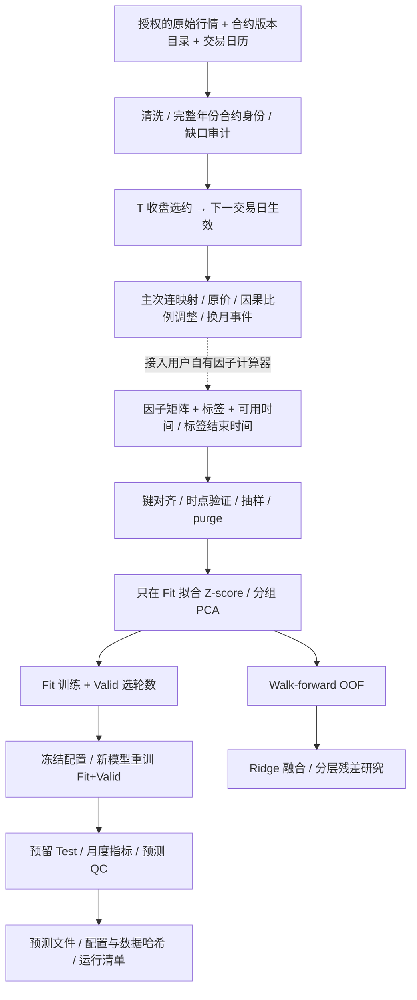

# 商品期货研究系统

本子系统将连续合约、因子数据工程、模型比较、分组融合和质量检查接成可安装的 Python 工具链。主流程可直接使用符合契约的自有因子矩阵；`quant_research.factor_bridge` 另提供可选的因子接口接入方式。`ashare_factor_lab` 中的九个股票因子仅展示已实现因子库的一部分，配套演示用于说明接口用法，不作为主流程的固定环节或必需输入。这里发布的是从研究材料整理的代码和合成示例，不包含真实行情、因子矩阵、交易凭据、模型权重或 Notebook 的历史输出。

## 快速运行

建议 Python 3.11 或 3.12，在仓库根目录运行：

```bash
python -m venv .venv
source .venv/bin/activate
python -m pip install -e '.[futures,futures-models,dev]'
python -m pytest -q
futures-research demo --output runs/demo
# 分别训练并冻结四个模型，再对同一个预留集做描述性比较
futures-research demo --models xgboost,lightgbm,transformer,itransformer --output runs/comparison
python tools/check_public_release.py
```

macOS 的 XGBoost/LightGBM 可能还需要系统 OpenMP 运行库；缺失会明确报依赖错误，不能据此视为模型已经验证。CPU 合成示例用于检验流程，数值无实盘含义。重复运行请使用新输出目录，系统拒绝覆盖已完成的研究结果。

## 系统结构



虚线连接是明确的用户接入点：原材料没有包含全部上游因子计算器，本项目不凭空补造专有因子。`demo` 使用公开定义的合成因子，真实数据用统一输入契约接入。

| 层 | 实现 | 主要能力 |
|---|---|---|
| 数据与连续合约 | `continuous.py`、`adapters.py` | 版本化合约目录、显式日历、主次连状态机、T+1 映射、缺行情保留 NaN |
| 因子工程 | `factor_processing`、`factor_grouping`、`factor_compression` | 固定 Fit 区间标准化、互斥因子分组、训练期 PCA 与状态指纹 |
| 样本工程 | `factor_sampling` | 精确时刻抽样、可用时间与标签结束时间、purged split |
| 模型 | `factor_model_training` | XGBoost、LightGBM、CatBoost 可选适配器、Transformer、iTransformer，两阶段训练 |
| 评估 | `factor_model_testing`、`factor_series_qc_v2` | 冻结模型测试、预测落盘、月度相关系数、形态 QC、前缀不变性检查 |
| 融合 | `factor_ridge_stacking`、`factor_hierarchical_residual` | Walk-forward OOF、Ridge 元模型、分层残差选择与晋级 |
| CTA 策略 | `cta_sector.py`、`cta_strategy.py`、`cta_portfolio.py` | 板块相对收益、独立训练、排名集成与区间研究回测 |
| 编排 | `pipeline.py`、`cli.py` | 数据契约、冻结处理器、运行配置、合成演示、不可覆盖的运行目录 |

## 防泄漏边界

- `Datetime` 是预测信息截止时间；`feature_available_at <= Datetime`，`label_end >= Datetime`。这些字段由数据提供方据实生成；程序无法从数值矩阵推断供应商是否事后修订了历史值。
- 训练/验证/测试必须按时间隔离；训练与选参先裁掉跨边界标签，再拟合处理器和模型。Test 标签是否已实现只影响评分，不改变预测或组合成员。六个采样点本身不保证标签不重叠；夜盘、节假日、交割日使用各自交易日历和实际标签结束时刻。
- 通用流水线的时间序列 Z-score、缺失填补、PCA 仅在 Fit 估计。CTA 策略的截面 z-score 只使用同时点、同板块信息，传播组内最晚可用时点，不沿时间估计。默认编排在最终重训时也冻结同一套处理器，避免配置变化混入模型比较；OOF 每折的上游处理器也必须只使用该折训练信息。
- Valid 只用于选择训练轮数；最终训练从新模型开始。多模型 Test 指标是描述性比较，使用 Test 排名后继续改参数会让它变成研究集，必须另留未查看的最终确认集。
- 连续价的换约跳变不能直接视为可实现收益。即使采用因果比例调整，也不能替代逐合约持仓、移仓成本、手续费与滑点模拟。
- 本仓库没有完成真实行情全量审计，也不声称这些检查足以证明整个研究无数据泄漏或未来可盈利。

## 文档与证据

- [商品期货截面多空 CTA：独立策略与研究回测](../strategies/sector_cta.md)
- [工作总结与来源对应](research_summary.md)
- [连续合约与数据契约](continuous.md)
- [因子处理、采样与 QC](factors.md)
- [训练、OOF 与融合](training.md)
- [本地数据接入及复现](reproducibility.md)
- [脱敏范围与发布检查](sanitization.md)
- [验证记录](verification.md)
- [全系统数据泄漏与逻辑复核](../system/leakage_audit.md)

本项目不默认连接任何数据库，不运行原 Notebook，不分发历史实证收益，不自动发布训练生成的文件。用户接入真实数据后产生的 `runs/`、`data/`、权重、Parquet 和凭据均在 Git 忽略范围内。
