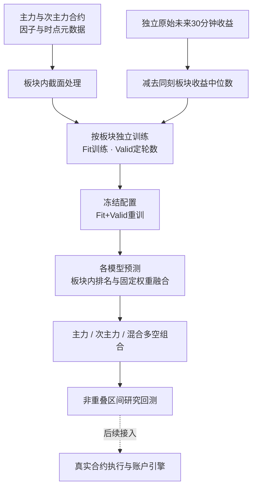

# 商品期货截面多空 CTA 策略

本策略按商品板块独立训练模型，预测合约相对于所属板块的未来收益，以集成信号构建主力、次主力合约的多空组合，并进行区间收益与交易成本评估。它是量化全流程系统中的独立策略成果，与[已实现的部分因子库](../ashare_factor_research.md)分别展示。

最新研究依据为来源 **S18** 的分板块 LightGBM Notebook。公开版保留其板块建模、截面标准化、Fit 段增强、两阶段训练和多空组合思路，并补充明确的标签构造、模型融合、时点校验与研究回测接口。原始行情、模型文件、私人路径、Notebook 输出和真实业绩均不公开。

## 策略逻辑

同一板块内，商品可能共同受到需求、库存、成本和宏观因素影响。策略关注合约之间的相对强弱：在板块内预测未来表现，做多相对强的合约、做空相对弱的合约，再按预先确定的资金比例组合各板块。

这是可检验的研究假设，不是关于盈利能力的结论。板块资金中性不等于波动率中性、产业链风险中性或保证金中性；主次力相关性、流动性、换月和交易成本仍会影响组合。



## 预测目标

默认预测目标为未来 30 分钟收益相对板块中位数的超额收益：

$$
r_{i,t}^{30m}=\frac{P_{i,t+30m}}{P_{i,t}}-1,\qquad
y_{i,t}=r_{i,t}^{30m}-\operatorname{median}_{j\in\mathcal U_{s(i),t}}r_{j,t}^{30m}.
$$

其中，$\mathcal U_{s(i),t}$ 是时点 $t$ 属于该板块、符合预先定义研究范围的合约集合。价格口径、30 分钟采用自然时间还是交易时间、午休及夜盘跨日处理，均须由数据供应方明确，并提供实际 `label_end`；不能用“后移若干行”代替这些定义。

- 默认模式使用上述 **median excess**。目标用于监督学习，未来收益不参与当时的特征、信号或选券。
- 兼容来源版本的 **source z-score** 模式，用于复现板块内标签标准化思路；它与默认目标是不同的实验配置，必须分别记录。
- 来源 Notebook 从外部文件读取 `Tag`，未包含它的上游构造过程。**不能假定 `Tag` 是未处理的原始收益**。默认模式要求输入独立、未经板块中心化的 `return_30m`，避免对已经处理的标签再次中心化。
- 主次力同时进入板块中位数时，同一品种会以两个合约角色参与截面。改变角色集合会改变基准，因此标签研究范围应与实验配置一起冻结。

## 板块处理与独立训练

来源版本使用黑色、金属、能源化工、农产品四组。这是研究者设定的分组，**不等同于官方行业分类**；公开演示使用虚构合约，真实研究应提供带版本的板块与合约角色映射。

每个板块按以下顺序处理：

1. 在同一时点、同一板块内对特征做截面 z-score，保留原始缺失值语义，处理零方差截面。
2. 记录截面共同依赖的可用时点。板块特征变换需要该截面参与成分全部可得；中位数标签需要参与成分的未来收益全部结束，因此分别以组内最晚时点约束特征与标签。
3. 可选地在 **Fit 段**生成同刻板块内的 Dirichlet 凸组合样本；Valid 和 Test 保持真实样本。增强配置和随机种子属于实验记录。
4. Stage 1 仅在 Fit 训练，用 Valid 选择训练轮数；按标签结束时间清除跨分区样本。
5. 冻结轮数及其他配置后，Stage 2 在 Fit+Valid 重新训练，最后才载入并评估 Test。

来源中的冻结轮数明确标注为旧目标遗留值，公开版不将其视为新目标下已经验证的参数。合成样本也不产生新的独立市场信息；是否使用增强，应在验证阶段做对照。

| 模型 | 在本策略中的定位 |
|---|---|
| LightGBM | 最新来源版本的实际训练模型，也是公开演示默认模型 |
| XGBoost | 接入统一模型接口的树模型对照 |
| Transformer | 时间序列建模对照 |
| iTransformer | 因子维度建模对照，与 Transformer 分别记录 |

四种模型可共同运行，但“公共接口支持”不等于来源 Notebook 已完成四模型实证。序列长度、窗口连贯性和缺失交易时段需要单独校验；不能将不相邻样本默认为连续分钟。

## 集成信号与主次力多空组合

每个模型的预测先转换为**同刻、同板块的百分位排名**，再按预先冻结的固定权重融合：

$$
q_{i,t}=\sum_{m\in\mathcal M}a_m\,\operatorname{rankpct}_{s(i),t}(\hat y^{(m)}_{i,t}),
\qquad a_m>0,\quad\sum_m a_m=1.
$$

这样融合的是板块内相对排序，不能把融合值直接解释为预期收益率。模型权重、分位数阈值和资金比例均不得依据 Test 收益挑选。

- 合约角色通过显式元数据区分 `main`、`secondary`，支持仅主力、仅次主力及两者混合；角色不是实际交易合约代码。
- 板块内依据集成信号选取多头与空头，两侧分别配权，并检查净敞口和总敞口。
- 默认使用 **PORT** 思路：各板块独立形成组合，再按固定板块资金比例汇总。缺失板块的资金不自动分给其他板块。
- 不直接把各板块模型的原始预测放在一起排名。来源中的 **POOL** 属于研究对照，原件也提示不同板块预测尺度不可比。
- 来源还探索了次主力信号映射到主力收益的 `02→01` 对照。正式跨腿执行需要时点有效的品种、角色、真实合约映射，不能只替换名称后缀。

## 回测范围与执行边界

来源 Notebook 已包含多空权重、成本、换手、净值和回撤等研究回测代码。公开版提供经过边界约束的**非重叠区间研究回测**，用于检查信号到组合的计算链路；完整真实合约执行与账户引擎继续保留后续接入口。

| 公开研究回测 | 后续完整执行引擎 |
|---|---|
| 收益提供独立的 `return_start`、`return_end`，区间严格不重叠 | 逐笔或逐 bar 成交、订单状态与持仓生命周期 |
| 要求信号在收益区间开始前已可得 | 数据延迟、下单延迟、撮合与成交价格 |
| 组合仅由信号和当时已知元数据决定 | 历史可交易范围、停牌、涨跌停、夜盘差异 |
| 已持仓资产缺失执行收益时拒绝计算 | 合约换月、真实交易代码和交割约束 |
| 每个研究区间独立开平并计入双边交易成本 | 持续持仓换手、手续费结构、冲击与容量 |
| 记录区间收益、成本与净值等研究产物 | 合约乘数、保证金、结算、资金占用和风险控制 |

区间开平的成本口径与持续持仓的换手成本口径不同，不能直接比较为同一回测结果。即使代码通过合成数据验证，也不能由此推出真实市场的收益、容量或可交易性。

## 真实数据契约

接入真实研究数据时，至少需要以下信息；文件与数据授权由使用者在本地管理：

| 数据 | 必须明确的内容 |
|---|---|
| 特征 | `Date / Contract / Datetime` 索引、因子定义与版本、`feature_available_at` |
| 训练收益 | 未经板块中心化的 `return_30m`、价格与窗口定义、`label_end` |
| 合约元数据 | 板块、主次力角色、映射生效时段、当时可交易状态 |
| 执行收益 | 与训练目标分离，包含真实可执行价格口径及起止时点 |
| 实验配置 | Fit/Valid/Test 边界、purge 规则、随机种子、增强、模型及融合参数 |

`cta_strategy.run_sector_strategy` 接受 `ResearchDataset`、延后调用的 Test loader、独立执行收益 loader、配置及新输出目录。全部板块模型冻结后才调用 Test loader，仓位固定后才调用执行收益 loader。总编排当前只支持整次运行固定的合约/板块/角色映射，并要求 `metadata_available_at` 不晚于每条历史样本；真实角色变更需上游按有效期处理，底层 `build_sector_weights` 支持按交易日或时点提供角色记录。不得把当前主力身份回填整个历史。

不得用未来收益是否缺失决定当前选券集合；不得将缺失持仓收益默认为零；不得将重复查看后的 Test 当作仍然未触碰的最终留出集。若使用新合约品种或最新板块划分回填历史，还需检查存续偏差和历史映射可得性。

## 公开演示

在仓库根目录、安装所需依赖后运行。演示使用虚构合约与合成数据，验证工程链路，不生成真实业绩证明。

```bash
python examples/run_sector_cta_demo.py --output runs/sector-cta
```

同时运行四种模型：

```bash
python examples/run_sector_cta_demo.py --output runs/sector-cta-four-models \
  --models xgboost,lightgbm,transformer,itransformer
```

示例配置见 [`configs/sector_cta.example.json`](../../configs/sector_cta.example.json)，日期、合约及参数均为合成验收设置。此配置供 `run_sector_strategy` API 使用，不能直接传给通用 `quant-research run`。来源 z-score 模式可通过 `--target-mode sector_zscore` 显式选择。

运行产物用于追踪标签、分板块训练、预测融合、组合与区间收益。复现时应保存数据指纹、有效配置、模型产物、依赖版本和审计记录；`runs/` 中的本地研究结果不随源码公开。

## 来源证据与公开改进

来源 S18 的文件摘要与迁移记录见[来源清单](../futures/source_manifest.json)。以下 cell 编号从 0 开始，用于对应原件，不包含原件输出。

| 来源证据 | 公开版处理 |
|---|---|
| cell 6：四板块、截面 z-score、Fit 段凸组合 | 提取为可复用处理接口，并传递截面共同依赖的最晚时点 |
| cells 8、11–14、19、21–23：LightGBM 两阶段分组训练 | 保留默认模型，复用统一训练框架接入其他模型 |
| cells 1–4：从外部读取 `Tag` | 显式构造默认 median-excess 目标，要求未经中心化的原始收益 |
| cell 17：旧目标下的冻结轮数 | 按当前目标重新验证，不复制旧轮数作为结论 |
| cell 24：训练完成后打开 Test | 配合标签结束时间隔离和实验审计，避免跨边界信息 |
| cells 36–37：组合与研究回测 | 将信号选券与未来收益彻底分开，拒绝缺失持仓收益，检查区间时序 |
| 来源未包含四模型预测融合 | 新增同板块排名后固定权重融合，明确其为公开整合扩展 |

原件 SHA256：`7004b2c7ec68044925eec7ed4e6bf48d6e1afed3e288083b6fc32d7cb475cd4b`。

相关入口：[仓库首页](../../README.md) · [期货研究模块](../futures/README.md) · [完整回测接入契约](../system/backtest_contract.md)
