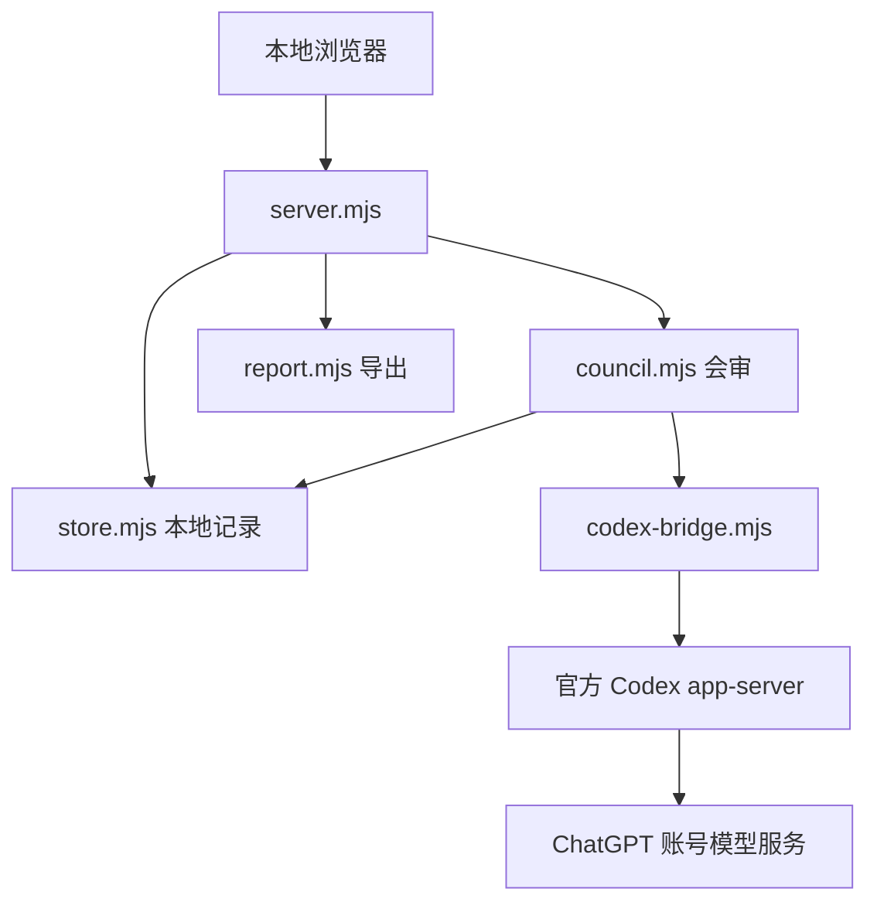

# 架构、处理步骤与验证方法

本文件解释当前代码实际做什么。所有涉及真实账号和研究结果的例子，必须在你自行登录并运行后读取；交付时未执行这些账号依赖步骤，没有虚构 QMT、数据库、行情或专家输出。实际执行过的检查统一记录在 [validation.md](validation.md)。

## 模块关系



默认服务地址为 `127.0.0.1:4317`。浏览器使用本地 HTTP API 与 SSE 获取状态和流式进度；服务端通过标准输入/输出与官方 Codex 进程交换 JSON-RPC 消息。每位专家及主持人各持有独立 thread，后续轮次恢复各自 thread。

## 按步骤理解输入、调用、输出和变化

下表的示例均在项目根目录运行。`npm test` 使用标记为虚构的协议夹具；它不读取真实金融环境。与账号有关的步骤只给可执行入口，不声称已经完成。

| 步骤与关键函数 | 作用和参数 | 真实输入 / 输入范围 | 可运行使用方式 | 输出与前后变化 |
| --- | --- | --- | --- | --- |
| 环境启动：`start.sh` / `start.ps1` | 检查 Node/npm，按锁文件安装缺失依赖，启动本地服务 | 本项目锁文件、本机环境 | `bash start.sh` 或 `powershell -File .\start.ps1` | 创建依赖与 `.local`；源码不变。你本机运行尚未执行 |
| 建立应用：`createApplication({dataDir, bridge, preview})` | 建立存储、HTTP 路由、SSE 和桥接；测试可注入 bridge | 实际 `.local`；默认官方 bridge | `npm start` | 默认监听本机地址；运行中任务在重启时标记中断，已有内容保留 |
| 进程隔离配置：`isolatedEnvironment(codexHome, source)`、`CodexBridge.start()` | 从允许清单复制环境；校验 0.163.0 并初始化进程 | 本机运行必需环境；本项目独立工作目录 | `npm run verify:protocol` | 启动真实未登录 Codex，得到实际协议结果；不继承 API Key，不产生金融结论 |
| 账号：`account()`、`login(type)`、`cancelLogin(loginId)`、`logout()` | 查询状态，开始/取消官方登录或退出 | 用户选择的 `chatgptDeviceCode` / `chatgpt` 流程 | 启动后在页面点击登录、取消或退出 | 只改变本项目账号状态；研究历史不因退出而删除。用户登录尚未执行 |
| 模型目录：`models()` | 分页读取官方模型目录 | Codex `model/list` 返回值 | `npm run verify:protocol`；页面模型选择器 | 得到名称与描述；不证明调用授权、额度或推理成功 |
| 连接验证：`POST /api/verify`、`generate({prompt, model, threadId})` | 第一次生成后重启 Codex；恢复 thread，核对随机 marker | 运行时生成的随机标识与选定模型；不含研究材料 | 页面登录后点击连接验证 | 2 次真实调用成功才设为已验证；仅已登录不放行研究。交付时尚未执行 |
| 研究校验：`validateResearch(body)` | 检查问题、轮数和材料大小，生成顺序材料 ID | 页面提交的真实文字材料 | 上传自己的 txt/md，在页面提交；也可运行下文“读取实际研究记录”示例 | 问题 trim，材料增加 E1/E2 等 ID；材料正文不改写；最多 12 份、60,000 字符、1–3 轮 |
| 专家设置：`validateExperts(value)` | 仅允许固定 3 个角色，修改各自方法说明 | 用户编辑的方法说明 | 页面编辑并保存专家方法 | 写入 `experts.json`；角色 ID/名称保留；不训练或修改模型权重 |
| 建立任务：`createRun({question, materials, model, maxRounds, experts})` | 创建任务 ID、时间、状态、预算与空记录 | 校验后的用户输入及专家设置快照 | `node --test --test-name-pattern="限制配置" tests/council.test.mjs` | 测试输入为虚构夹具；真实运行新增 run，calls=0、status=running，maxCalls=12 |
| 专家首轮：`executeCouncil(run,{bridge,onUpdate,signal})`、`expertPrompt()` | 并行向 3 个独立 thread 提问；首轮不提供其他专家意见 | 当前任务材料和各自方法说明 | `node --test --test-name-pattern="首轮三个独立线程" tests/council.test.mjs` | 3 份结构化意见；每份保留立场、论据、材料 ID、风险、缺口、自报置信度；测试替身输出不是模型结果 |
| 格式校验：`parseOpinion()`、`parseModeration()` | 严格检查 JSON 字段、类型、枚举和数值范围 | Codex 实际回复字符串；测试时为固定夹具 | `node --test --test-name-pattern="格式失败" tests/council.test.mjs` | 成功转成对象；失败标记 failed，保留原始文本及其他成功意见，不伪造替代答案 |
| 主持与证据检查：`moderatorPrompt()`、`applyIntegrity()` | 综合观点；保留专家缺口，检查材料 ID 与立场冲突 | 本轮结构化意见和已提交材料 ID | `node --test --test-name-pattern="不存在的材料引用" tests/council.test.mjs` | 无效 ID 或必要资料不足转为 needs_evidence；只查 ID 存在性，材料语义和事实真实性不变为“已核实” |
| 后续讨论：`executeCouncil()`、`thread/resume` | 仅有未解分歧时继续，带入上一轮观点 | 上一轮意见与原始材料 | `node --test --test-name-pattern="主持人声称一致" tests/council.test.mjs` | 同一任务最多 3 轮/12 调用；保留分歧，不无限循环或强求一致 |
| 保存：`Store.read/write/runs()`、`recoverInterrupted()` | JSON 读取、临时文件写入后重命名、历史排序、中断标记 | 当前 `.local/runs/*.json` 等本地记录 | 完成/取消一次真实研究后运行下文读取示例 | 新增/更新记录；异常重启将 running 改为 failed/interrupted，不重新生成旧内容 |
| 取消与关闭：`AbortController`、`CodexBridge.close()` | 中止当前模型轮次并停止进程 | 页面取消或终端 Ctrl+C | `node --test --test-name-pattern="取消时保留" tests/council.test.mjs` | 已完成意见和已保存片段保留；未完成结果不被标成完成 |
| 错误处理：`redactError()`、RPC 超时与终态检查 | 脱敏常见凭据格式；等待 completed 终态，限制运行时间和输出量 | 真实错误或协议事件 | `npm test` 与 `npm run verify:protocol` | 保留可读错误而非伪造回复；脱敏属于有限规则，不替代凭据保护 |
| 报告：`renderReport(run)` | 将实际保存的任务渲染为 Markdown | 真实任务 JSON | 页面历史记录中导出报告；或运行下文只读示例 | 转换展示格式；包括原始材料；没有 final 时明确写尚未生成最终结论，不补造分析 |

表中 `parseOpinion`、`parseModeration`、`expertPrompt`、`moderatorPrompt`、`applyIntegrity` 是模块内部函数，通过 `executeCouncil` 测试整体行为；示例没有要求修改导出接口。

## 读取实际研究记录：可直接运行的只读示例

作用：读取你实际运行后最新保存的研究任务，打印材料前几段、关键类型、状态和报告预览。输入是本地真实 JSON，不连接 QMT、数据库或模型服务；不复制凭据。**交付时尚无用户真实研究记录，因此此真实数据示例尚未执行。**

使用：在项目根目录的 Bash 中执行以下整条命令。

```text
node --input-type=module -e 'import { Store } from "./src/store.mjs"; import { renderReport } from "./src/report.mjs"; const store = new Store(".local"); const runs = store.runs(); if (!runs.length) { console.log("尚无真实研究记录；请先在页面登录、验证并运行一次研究。"); } else { const run = runs[0]; const before = JSON.stringify(run); console.log("真实输入摘要：", { id: run.id, question: run.question, materials: run.materials.length, rounds: run.rounds.length, status: run.status }); console.table(run.materials.map(m => ({ id: m.id, title: m.title, textType: typeof m.text, characters: m.text.length, preview: m.text.slice(0, 120) }))); const report = renderReport(run); console.log("实际报告前 1500 字符：\n" + report.slice(0, 1500)); console.log("前后变化：", { runUnchanged: before === JSON.stringify(run), sourceMaterials: run.materials.length, reportType: typeof report, reportCharacters: report.length }); }'
```

Windows PowerShell 使用以下等价入口，避免旧版 PowerShell 对传给 `node -e` 的引号重新解析：

```powershell
@'
import { Store } from './src/store.mjs';
import { renderReport } from './src/report.mjs';
const store = new Store('.local');
const runs = store.runs();
if (!runs.length) {
  console.log('No real research records yet. Sign in, verify, then run one research task.');
} else {
  const run = runs[0];
  const before = JSON.stringify(run);
  console.log({ id: run.id, question: run.question, materials: run.materials.length, rounds: run.rounds.length, status: run.status });
  console.table(run.materials.map(m => ({ id: m.id, title: m.title, textType: typeof m.text, characters: m.text.length, preview: m.text.slice(0, 120) })));
  const report = renderReport(run);
  console.log(report.slice(0, 1500));
  console.log({ runUnchanged: before === JSON.stringify(run), sourceMaterials: run.materials.length, reportType: typeof report, reportCharacters: report.length });
}
'@ | node --input-type=module
```

此 PowerShell 示例与上面的 Bash 示例读取同一真实输入，输出同类摘要，前后变化相同；也尚未在用户真实记录上执行。提示语使用 ASCII，避免旧版 PowerShell 的管道编码改写脚本中的中文字符串。

实际输出：由命令打印你自己的记录；此处不预填内容。如果没有记录，会明确输出“尚无真实研究记录”。前后变化：已有 run 对象和磁盘记录保持原值，材料数量与类型不变，新增的仅是内存中的 Markdown 字符串；如 `.local` 尚不存在，`Store` 会创建空目录。

## 登录与会话恢复的检查边界

连接可分为四个层次，不能互相代替：

| 检查层次 | 证明什么 | 未证明什么 |
| --- | --- | --- |
| 真实 Codex 启动并初始化 | 安装版本和 JSON-RPC 基本兼容 | 用户已登录、可调用模型 |
| `account/read` 显示 ChatGPT | 当前独立 Codex 保存了 ChatGPT 登录状态 | 选定模型有权限、额度充足、生成可用 |
| 两轮连接验证且进程重启 | 当前真实调用可完成；持久化 thread 可恢复此前随机标识 | 投资分析质量、完整系统可靠性、所有模型均可用 |
| 人工复核真实研究案例 | 对已检查的案例提供质量证据 | 所有新问题均正确、投资收益或训练已完成 |

`generate()` 对新角色调用 `thread/start`，对已有角色调用 `thread/resume`，然后启动 turn，收集事件并等待 `turn/completed`。连接验证使用同样通路，第一轮与第二轮之间确实重启 Codex 进程；因此没有把同一进程的内存缓存误称为持久会话恢复。

## 数据与权限边界

`Store` 保存问题、材料、专家说明快照、每轮意见、thread ID、流式文本、原始响应、综合结果和错误。原始文本会进入本地记录，并在真实推理时发送给所用模型服务；“本地平台”不意味着模型在本机离线运行。

本项目为个人本地原型，默认只允许本机同源访问，并为修改请求要求本页 CSRF token。独立 Codex 配置关闭工具、搜索、MCP、插件等入口，设置只读运行并拒绝服务端工具授权请求。这些是应用约束，不是跨操作系统验证过的沙箱保证。不能暴露到共享网络并当作多租户服务。

官方 managed ChatGPT 登录由 Codex 管理 OAuth 与令牌，本项目没有自行解析或向网页返回 token。后续 SIWC 路线需要应用自己的注册/授权及 host 生命周期设计，当前未实现。官方认证适用范围见 [Codex App Server](https://learn.chatgpt.com/docs/app-server) 和 [Sign in with ChatGPT](https://developers.openai.com/siwc/token-sharing-open-source)，不应把本项目认证用于商业或托管服务。

下一阶段接入真实数据库、检索、计算工具或训练模型时，应保留这份处理链结构，为每项新处理补充实际输入、可运行调用、真实输出和前后变化，并重新执行相应验证。
