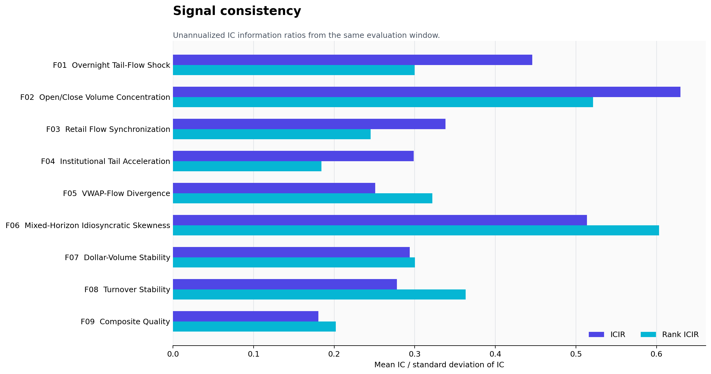

# Empirical results

This directory contains sanitized historical evaluator outputs for all nine factors. Raw market
data, factor parquet files, internal paths, and peer-factor identifiers are intentionally omitted.

## Full-sample comparison

| ID | Factor | Category | IC | 5-day IC | Rank IC | ICIR | Coverage | Status |
|---|---|---|---:|---:|---:|---:|---:|---|
| F01 | [Overnight Tail-Flow Shock](factor_reports/f01_overnight_tail_flow_shock.md) | Microstructure | 0.0227 | 0.0217 | 0.0172 | 0.4457 | 98.26% | Passed |
| F02 | [Open/Close Volume Concentration](factor_reports/f02_open_close_volume_concentration.md) | Microstructure | 0.0408 | 0.0537 | 0.0404 | 0.6297 | 99.99% | Passed |
| F03 | [Retail Flow Synchronization](factor_reports/f03_retail_flow_synchronization.md) | Microstructure | 0.0206 | 0.0203 | 0.0150 | 0.3382 | 81.90% | Diagnostic |
| F04 | [Institutional Tail Acceleration](factor_reports/f04_institutional_tail_acceleration.md) | Microstructure | 0.0123 | 0.0176 | 0.0095 | 0.2987 | 78.16% | Passed |
| F05 | [VWAP-Flow Divergence](factor_reports/f05_vwap_flow_divergence.md) | Microstructure | 0.0112 | 0.0190 | 0.0159 | 0.2509 | 99.96% | Passed |
| F06 | [Mixed-Horizon Idiosyncratic Skewness](factor_reports/f06_mixed_horizon_idiosyncratic_skewness.md) | Risk | 0.0226 | 0.0260 | 0.0296 | 0.5136 | 100.00% | Passed |
| F07 | [Dollar-Volume Stability](factor_reports/f07_dollar_volume_stability.md) | Trading activity | 0.0227 | 0.0274 | 0.0263 | 0.2938 | 100.00% | Passed |
| F08 | [Turnover Stability](factor_reports/f08_turnover_stability.md) | Trading activity | 0.0128 | 0.0153 | 0.0191 | 0.2780 | 100.00% | Passed |
| F09 | [Composite Quality](factor_reports/f09_composite_quality.md) | Fundamental | 0.0107 | 0.0192 | 0.0129 | 0.1805 | 100.00% | Diagnostic |

## Interpretation

- Seven factors passed the configured performance/correlation gate.
- F03 remains economically interesting but has lower coverage and excessive overlap with the
  comparison library; it is retained as a diagnostic case rather than presented as production-ready.
- F09 uses a shorter sample ending in May 2018 and did not pass every check; its 2017–2018 results
  motivate further point-in-time data and specification work.
- F02 has the strongest full-sample IC and 5-day IC in this collection.
- F06 combines full coverage with the highest rank ICIR.

## Files

- `summary.csv`: one full-sample row per factor;
- `annual_metrics.csv`: year-level stability metrics;
- `factor_reports/`: one detailed report per factor;
- `full_reports/`: archived source evaluator panels;
- `figures/`: regenerated public comparison charts.

Historical results are research diagnostics, not live performance or investment advice. They do
not include transaction costs, capacity limits, or a claim of future persistence.
