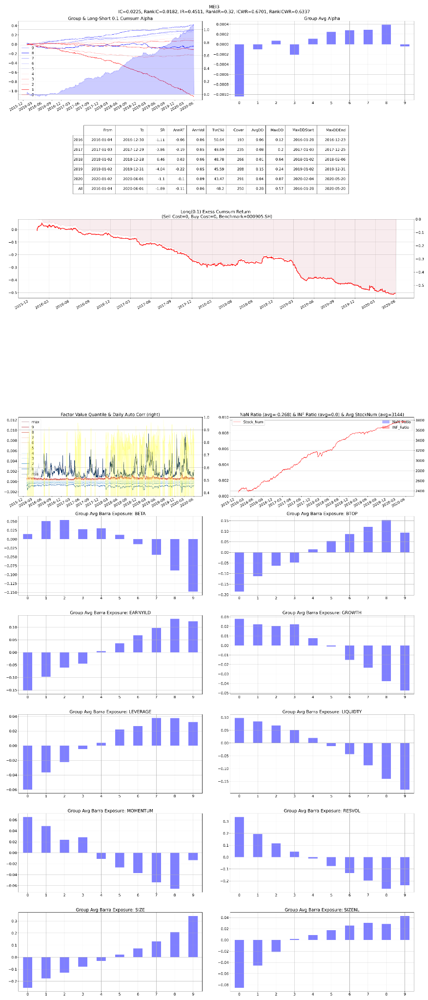

# F01 — Overnight Tail-Flow Shock

- **Category:** `microstructure`
- **Evaluation window:** 2016-01-04 to 2020-05-29
- **Research status:** `passed` — Passed the configured research evaluation gate.

## Full-sample summary

| IC | 5-day IC | Rank IC | ICIR | Rank ICIR | Coverage | Days |
|---:|---:|---:|---:|---:|---:|---:|
| 0.0227 | 0.0217 | 0.0172 | 0.4457 | 0.2999 | 98.26% | 1071 |

## Annual diagnostics

| Year | IC | 5-day IC | Rank IC | ICIR | Coverage | Days |
|---:|---:|---:|---:|---:|---:|---:|
| 2016 | 0.0130 | 0.0133 | 0.0106 | 0.2469 | 96.61% | 244 |
| 2017 | 0.0186 | 0.0273 | 0.0163 | 0.3591 | 97.72% | 244 |
| 2018 | 0.0270 | 0.0185 | 0.0194 | 0.6313 | 98.33% | 243 |
| 2019 | 0.0291 | 0.0251 | 0.0206 | 0.5749 | 99.76% | 244 |
| 2020 | 0.0308 | 0.0286 | 0.0227 | 0.5140 | 99.82% | 96 |

## Archived evaluation panel

The panel below is retained as supplied by the original research evaluator. Historical labelling
is preserved; no raw market data or factor parquet is distributed.

