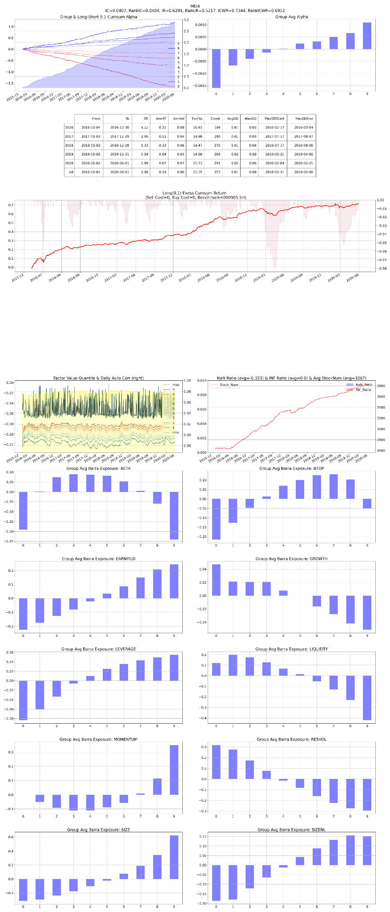

# F02 — Open/Close Volume Concentration

- **Category:** `microstructure`
- **Evaluation window:** 2016-01-04 to 2020-05-29
- **Research status:** `passed` — Passed the configured research evaluation gate.

## Full-sample summary

| IC | 5-day IC | Rank IC | ICIR | Rank ICIR | Coverage | Days |
|---:|---:|---:|---:|---:|---:|---:|
| 0.0408 | 0.0537 | 0.0404 | 0.6297 | 0.5214 | 99.99% | 1071 |

## Annual diagnostics

| Year | IC | 5-day IC | Rank IC | ICIR | Coverage | Days |
|---:|---:|---:|---:|---:|---:|---:|
| 2016 | 0.0388 | 0.0481 | 0.0387 | 0.6052 | 99.98% | 244 |
| 2017 | 0.0483 | 0.0749 | 0.0483 | 0.8208 | 99.98% | 244 |
| 2018 | 0.0376 | 0.0483 | 0.0378 | 0.5619 | 99.99% | 243 |
| 2019 | 0.0408 | 0.0493 | 0.0412 | 0.6243 | 100.00% | 244 |
| 2020 | 0.0345 | 0.0392 | 0.0297 | 0.4751 | 100.00% | 96 |

## Archived evaluation panel

The panel below is retained as supplied by the original research evaluator. Historical labelling
is preserved; no raw market data or factor parquet is distributed.

