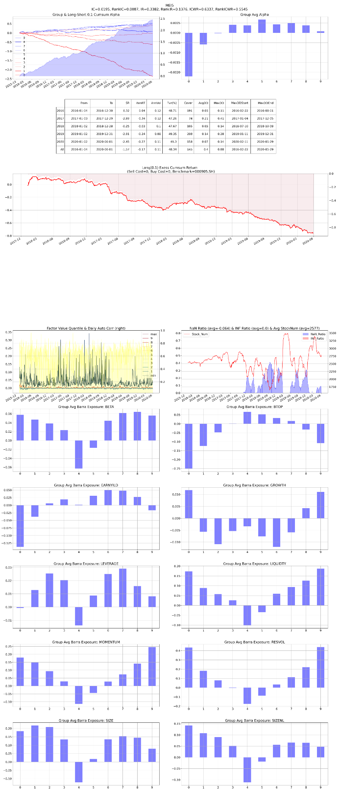

# F03 — Retail Flow Synchronization

- **Category:** `microstructure`
- **Evaluation window:** 2016-01-04 to 2020-05-29
- **Research status:** `diagnostic` — Retained as a diagnostic research case; not every configured check passed.

## Full-sample summary

| IC | 5-day IC | Rank IC | ICIR | Rank ICIR | Coverage | Days |
|---:|---:|---:|---:|---:|---:|---:|
| 0.0206 | 0.0203 | 0.0150 | 0.3382 | 0.2453 | 81.90% | 1071 |

## Annual diagnostics

| Year | IC | 5-day IC | Rank IC | ICIR | Coverage | Days |
|---:|---:|---:|---:|---:|---:|---:|
| 2016 | 0.0254 | 0.0337 | 0.0224 | 0.3769 | 98.89% | 244 |
| 2017 | 0.0167 | 0.0151 | 0.0136 | 0.2751 | 86.66% | 244 |
| 2018 | 0.0200 | 0.0149 | 0.0150 | 0.3706 | 67.95% | 243 |
| 2019 | 0.0213 | 0.0179 | 0.0094 | 0.3624 | 73.78% | 244 |
| 2020 | 0.0177 | 0.0193 | 0.0143 | 0.2715 | 82.62% | 96 |

## Archived evaluation panel

The panel below is retained as supplied by the original research evaluator. Historical labelling
is preserved; no raw market data or factor parquet is distributed.

