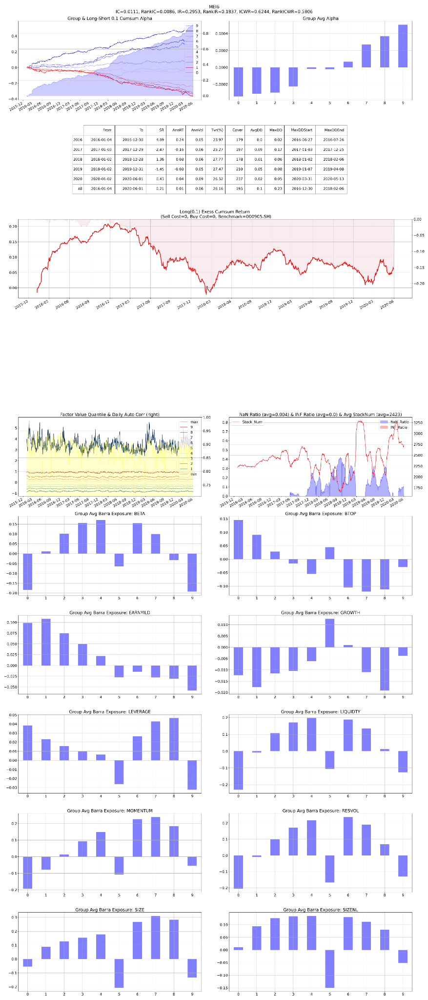

# F04 — Institutional Tail Acceleration

- **Category:** `microstructure`
- **Evaluation window:** 2016-01-04 to 2020-05-29
- **Research status:** `passed` — Passed the configured research evaluation gate.

## Full-sample summary

| IC | 5-day IC | Rank IC | ICIR | Rank ICIR | Coverage | Days |
|---:|---:|---:|---:|---:|---:|---:|
| 0.0123 | 0.0176 | 0.0095 | 0.2987 | 0.1842 | 78.16% | 1071 |

## Annual diagnostics

| Year | IC | 5-day IC | Rank IC | ICIR | Coverage | Days |
|---:|---:|---:|---:|---:|---:|---:|
| 2016 | 0.0100 | 0.0164 | 0.0028 | 0.2043 | 89.97% | 244 |
| 2017 | 0.0105 | 0.0132 | 0.0095 | 0.2665 | 82.26% | 244 |
| 2018 | 0.0145 | 0.0186 | 0.0160 | 0.3627 | 66.19% | 243 |
| 2019 | 0.0105 | 0.0156 | 0.0064 | 0.2980 | 72.80% | 244 |
| 2020 | 0.0223 | 0.0350 | 0.0175 | 0.5298 | 81.59% | 96 |

## Archived evaluation panel

The panel below is retained as supplied by the original research evaluator. Historical labelling
is preserved; no raw market data or factor parquet is distributed.

