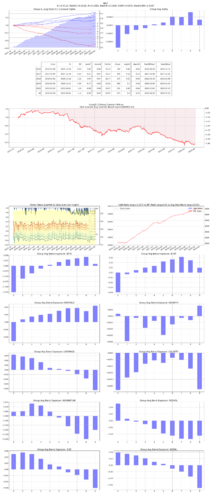

# F05 — VWAP-Flow Divergence

- **Category:** `microstructure`
- **Evaluation window:** 2016-01-04 to 2020-05-29
- **Research status:** `passed` — Passed the configured research evaluation gate.

## Full-sample summary

| IC | 5-day IC | Rank IC | ICIR | Rank ICIR | Coverage | Days |
|---:|---:|---:|---:|---:|---:|---:|
| 0.0112 | 0.0190 | 0.0159 | 0.2509 | 0.3219 | 99.96% | 1071 |

## Annual diagnostics

| Year | IC | 5-day IC | Rank IC | ICIR | Coverage | Days |
|---:|---:|---:|---:|---:|---:|---:|
| 2016 | 0.0127 | 0.0216 | 0.0194 | 0.2807 | 99.92% | 244 |
| 2017 | 0.0113 | 0.0196 | 0.0141 | 0.2561 | 99.94% | 244 |
| 2018 | 0.0131 | 0.0234 | 0.0154 | 0.2952 | 99.96% | 243 |
| 2019 | 0.0066 | 0.0098 | 0.0127 | 0.2038 | 100.00% | 244 |
| 2020 | 0.0142 | 0.0235 | 0.0205 | 0.2111 | 100.00% | 96 |

## Archived evaluation panel

The panel below is retained as supplied by the original research evaluator. Historical labelling
is preserved; no raw market data or factor parquet is distributed.

