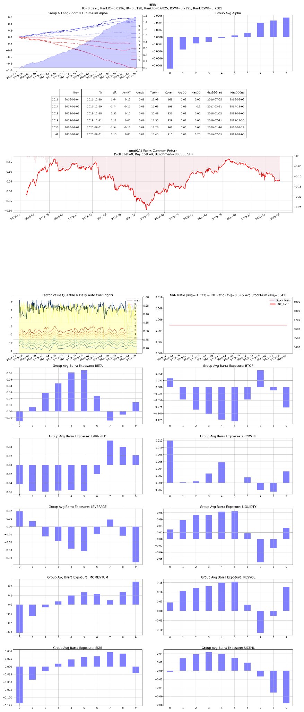

# F06 — Mixed-Horizon Idiosyncratic Skewness

- **Category:** `risk`
- **Evaluation window:** 2016-01-04 to 2020-05-29
- **Research status:** `passed` — Passed the configured research evaluation gate.

## Full-sample summary

| IC | 5-day IC | Rank IC | ICIR | Rank ICIR | Coverage | Days |
|---:|---:|---:|---:|---:|---:|---:|
| 0.0226 | 0.0260 | 0.0296 | 0.5136 | 0.6033 | 100.00% | 1071 |

## Annual diagnostics

| Year | IC | 5-day IC | Rank IC | ICIR | Coverage | Days |
|---:|---:|---:|---:|---:|---:|---:|
| 2016 | 0.0194 | 0.0315 | 0.0292 | 0.4278 | 100.00% | 244 |
| 2017 | 0.0235 | 0.0360 | 0.0318 | 0.5313 | 100.00% | 244 |
| 2018 | 0.0259 | 0.0256 | 0.0299 | 0.6734 | 100.00% | 243 |
| 2019 | 0.0273 | 0.0207 | 0.0330 | 0.7050 | 100.00% | 244 |
| 2020 | 0.0081 | 0.0011 | 0.0159 | 0.1351 | 100.00% | 96 |

## Archived evaluation panel

The panel below is retained as supplied by the original research evaluator. Historical labelling
is preserved; no raw market data or factor parquet is distributed.

