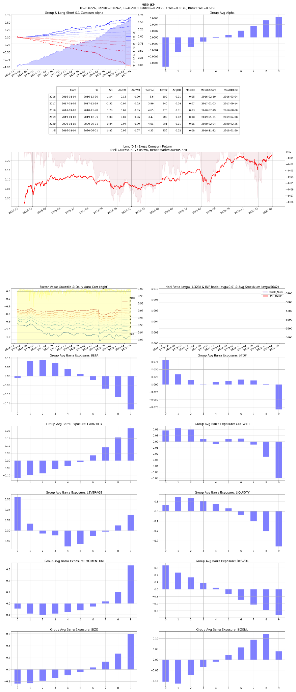

# F07 — Dollar-Volume Stability

- **Category:** `trading_activity`
- **Evaluation window:** 2016-01-04 to 2020-05-29
- **Research status:** `passed` — Passed the configured research evaluation gate.

## Full-sample summary

| IC | 5-day IC | Rank IC | ICIR | Rank ICIR | Coverage | Days |
|---:|---:|---:|---:|---:|---:|---:|
| 0.0227 | 0.0274 | 0.0263 | 0.2938 | 0.3001 | 100.00% | 1071 |

## Annual diagnostics

| Year | IC | 5-day IC | Rank IC | ICIR | Coverage | Days |
|---:|---:|---:|---:|---:|---:|---:|
| 2016 | 0.0166 | 0.0192 | 0.0184 | 0.2520 | 100.00% | 244 |
| 2017 | 0.0209 | 0.0319 | 0.0283 | 0.2450 | 100.00% | 244 |
| 2018 | 0.0149 | 0.0082 | 0.0186 | 0.1959 | 100.00% | 243 |
| 2019 | 0.0312 | 0.0431 | 0.0335 | 0.4238 | 100.00% | 244 |
| 2020 | 0.0407 | 0.0453 | 0.0426 | 0.4540 | 100.00% | 96 |

## Archived evaluation panel

The panel below is retained as supplied by the original research evaluator. Historical labelling
is preserved; no raw market data or factor parquet is distributed.

