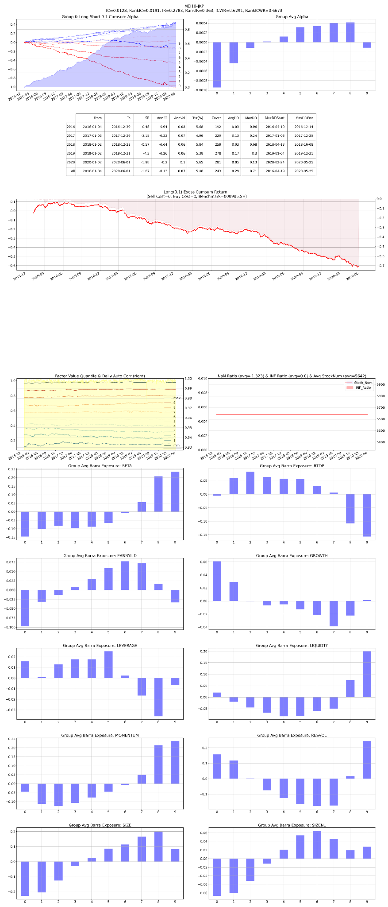

# F08 — Turnover Stability

- **Category:** `trading_activity`
- **Evaluation window:** 2016-01-04 to 2020-05-29
- **Research status:** `passed` — Passed the configured research evaluation gate.

## Full-sample summary

| IC | 5-day IC | Rank IC | ICIR | Rank ICIR | Coverage | Days |
|---:|---:|---:|---:|---:|---:|---:|
| 0.0128 | 0.0153 | 0.0191 | 0.2780 | 0.3632 | 100.00% | 1071 |

## Annual diagnostics

| Year | IC | 5-day IC | Rank IC | ICIR | Coverage | Days |
|---:|---:|---:|---:|---:|---:|---:|
| 2016 | 0.0154 | 0.0182 | 0.0198 | 0.4055 | 100.00% | 244 |
| 2017 | 0.0151 | 0.0219 | 0.0223 | 0.3089 | 100.00% | 244 |
| 2018 | 0.0126 | 0.0141 | 0.0193 | 0.2935 | 100.00% | 243 |
| 2019 | 0.0072 | 0.0083 | 0.0130 | 0.1774 | 100.00% | 244 |
| 2020 | 0.0150 | 0.0124 | 0.0246 | 0.2118 | 100.00% | 96 |

## Archived evaluation panel

The panel below is retained as supplied by the original research evaluator. Historical labelling
is preserved; no raw market data or factor parquet is distributed.

