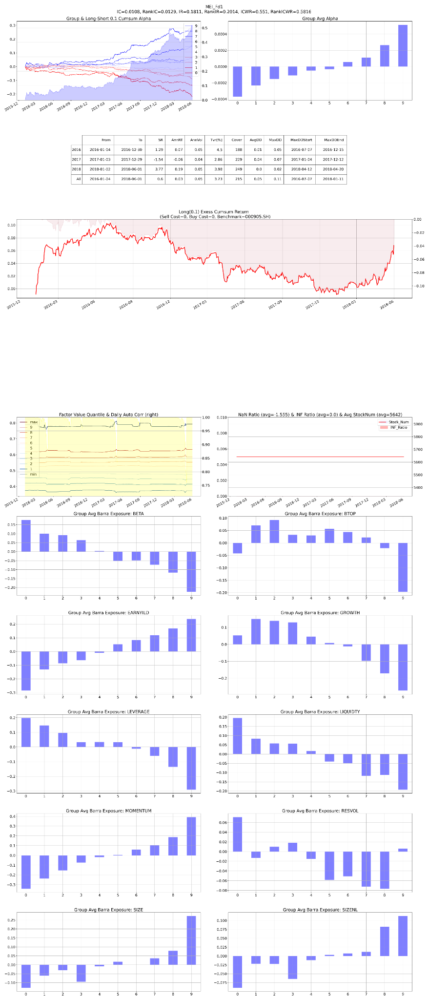

# F09 — Composite Quality

- **Category:** `fundamental`
- **Evaluation window:** 2016-01-04 to 2018-05-31
- **Research status:** `diagnostic` — Retained as a diagnostic research case; not every configured check passed.

## Full-sample summary

| IC | 5-day IC | Rank IC | ICIR | Rank ICIR | Coverage | Days |
|---:|---:|---:|---:|---:|---:|---:|
| 0.0107 | 0.0192 | 0.0129 | 0.1805 | 0.2019 | 100.00% | 586 |

## Annual diagnostics

| Year | IC | 5-day IC | Rank IC | ICIR | Coverage | Days |
|---:|---:|---:|---:|---:|---:|---:|
| 2016 | 0.0021 | 0.0036 | 0.0032 | 0.0394 | 100.00% | 244 |
| 2017 | 0.0169 | 0.0317 | 0.0199 | 0.2945 | 100.00% | 244 |
| 2018 | 0.0169 | 0.0266 | 0.0196 | 0.2255 | 100.00% | 98 |

## Archived evaluation panel

The panel below is retained as supplied by the original research evaluator. Historical labelling
is preserved; no raw market data or factor parquet is distributed.

